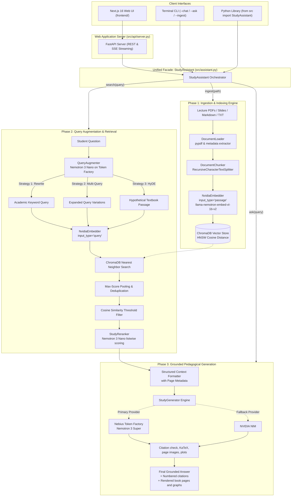
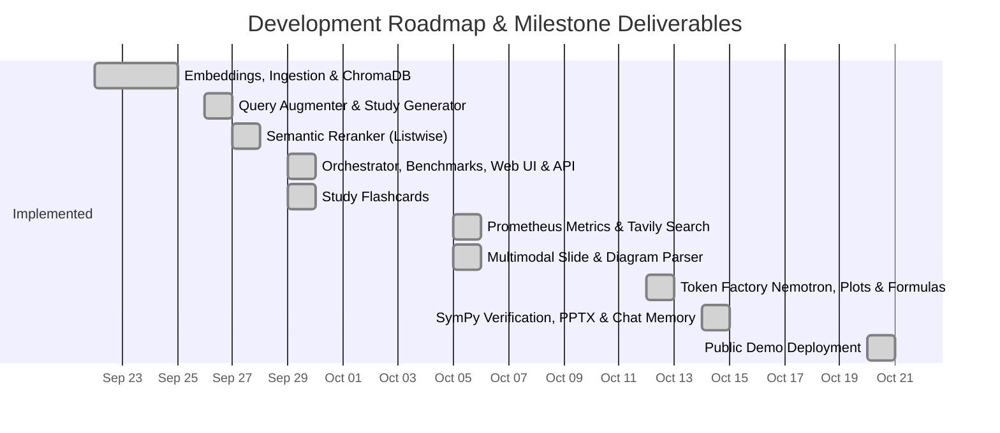

<div align="center">

#  Study Assistant: Grounded Academic RAG Tutor
### *Grounded academic tutor on NVIDIA Nemotron via Nebius Token Factory*

[](https://www.python.org/)
[](https://developer.nvidia.com/nim)
[](https://tokenfactory.nebius.com/)
[](https://github.com/Khazar451/study-assistant)
[](https://www.trychroma.com/)
[](tests/)
[](https://github.com/Khazar451/study-assistant/actions)
[](https://opensource.org/licenses/MIT)

*Developed for the **Nebius x NVIDIA Global AI Hackathon**.*

---

</div>

## For judges

- **Track:** Best Apps and Agents. Also eligible for Best Use of Tavily.
- **Required runtime:** Chat completions go to **Nebius Token Factory** (`https://api.tokenfactory.nebius.com/v1/`). Answers use NVIDIA **Nemotron 3 Super** (`nvidia/nemotron-3-super-120b-a12b`); derivations, proofs and calculations are escalated to **Nemotron 3 Ultra** (`nvidia/Nemotron-3-Ultra-550b-a55b`) with automatic fallback to Super. Query rewrite and rerank use NVIDIA **Nemotron 3 Nano** (`nvidia/NVIDIA-Nemotron-3-Nano-30B-A3B`). Embeddings stay on NVIDIA NIM (`nvidia/llama-nemotron-embed-vl-1b-v2`).
- **5-minute run:** copy `.env.example` to `.env.local`, set `NEBIUS_API_KEY`, `NVIDIA_API_KEY`, and `TAVILY_API_KEY`, then `bin/study-assistant`. Open the printed frontend URL. Under **Notes**, load a PDF (up to 200 MB). Ask a question with the source switch on **Notes**, **Web**, or **Both**. A cited page is drawn under the answer. Ask for a plot and a comparison and the reply includes a rendered graph and a markdown table.
- **What makes it different:** math in answers is **checked with SymPy** and shown with a "verified" card (the model is not just trusted); every citation renders the **actual source page**; the student chooses **Notes / Web / Both** so grounding is explicit; chat history persists across sessions.
- **Built during the submission window (opened 26 Aug 2026):** this repository's first commit is 17 Sep 2026, so the whole project is new work. Grounded RAG tutor, Token Factory Nemotron routing (Super, Nano, Ultra), Tavily academic search, numbered citations, KaTeX formulas, SymPy verification, cited-page images, 2D/3D plots, persistent chat memory, PPTX and slide-image ingestion, flashcards, Next.js + FastAPI UI, tests and CI.
- **How Token Factory helped:** the stock `openai` client works against Token Factory with only a base URL and key change, so moving from NVIDIA NIM touched one function (`src/providers.py`). One key serves Nano, Super and Ultra, which is what lets the app route each pipeline stage to a different Nemotron size.
- **Feedback on Nebius and NVIDIA tooling:** see [FEEDBACK.md](FEEDBACK.md).
- **Benchmark table** later in this README comes from `python -m evaluation.benchmark --mock`, which returns fixed values for CI. It is not a quality measurement (see section 3.7).

---

##  Table of Contents
- [1. Executive Summary & Problem Statement](#1-executive-summary--problem-statement)
- [2. System Architecture](#2-system-architecture)
- [3. What We Have Built So Far (Current Implementation)](#3-what-we-have-built-so-far-current-implementation)
  - [3.1 Ingestion & Indexing Engine](#31-ingestion--indexing-engine-srcingestion)
  - [3.2 Advanced Retrieval & Query Intelligence](#32-advanced-retrieval--query-intelligence-srcretrieval)
  - [3.3 Grounded Generation Engine & Guardrails](#33-grounded-generation-engine--guardrails-srcgeneration)
  - [3.4 Unified Assistant Orchestrator & CLI](#34-unified-assistant-orchestrator--cli-srcassistantpy)
  - [3.5 Automated Testing & CI/CD Pipeline](#35-automated-testing--cicd-pipeline-tests--github)
  - [3.6 Modern Web Application & REST API Layer](#36-modern-web-application--rest-api-layer-frontend--srcapi)
  - [3.7 Quantitative Academic Evaluation & Benchmark Suite](#37-quantitative-academic-evaluation--benchmark-suite-evaluation)
  - [3.8 Differentiators: Verified Math, Model Routing, Persistent Memory](#38-differentiators-verified-math-model-routing-persistent-memory)
  - [3.9 Deploying a Public Demo Safely](#39-deploying-a-public-demo-safely)
- [4. Roadmap & Upcoming Implementations](#4-roadmap--upcoming-implementations)
- [5. Repository Structure](#5-repository-structure)
- [6. Getting Started & Quickstart](#6-getting-started--quickstart)
  - [6.1 Prerequisites & Installation](#61-prerequisites--installation)
  - [6.2 Environment Configuration](#62-environment-configuration)
  - [6.3 Unified CLI Usage (Chat, Ask & Ingest)](#63-unified-cli-usage-chat-ask--ingest)
  - [6.4 End-to-End Python API Example](#64-end-to-end-python-api-example)
  - [6.5 Running the Web Application](#65-running-the-web-application)
  - [6.6 Running the Test Suite](#66-running-the-test-suite)
  - [6.7 Running Academic Benchmarks](#67-running-academic-benchmarks)
- [7. Questions for Faculty Advisors & Academic Feedback](#7-questions-for-faculty-advisors--academic-feedback)
- [8. Hackathon Evaluation Alignment](#8-hackathon-evaluation-alignment)
- [9. License & Acknowledgments](#9-license--acknowledgments)

---

## 1. Executive Summary & Problem Statement

### The Academic Challenge
Modern university students and researchers are routinely overwhelmed by hundreds of pages of lecture slides, syllabus documents, academic papers, and textbooks across multiple courses. While general-purpose Large Language Models (LLMs) provide rapid answers, they exhibit critical flaws in academic contexts:
1. **Hallucinations & False Assertions:** Generic models invent plausible-sounding equations, theorems, and historical dates.
2. **Lack of Attribution:** Students cannot verify where an explanation originated, making generic AI unsuitable for exam preparation or citation.
3. **Colloquial Query Mismatches:** Students frequently formulate informal, vague study queries that fail to match the formal terminology used in textbooks.

### Our Solution
**Study Assistant** is an end-to-end, grounded **Retrieval-Augmented Generation (RAG)** platform designed specifically for higher education. It transforms dense course documents into an interactive, pedagogical AI tutor with:
- **Grounded answers:** the tutor is instructed to answer only from the retrieved course materials (or academic web pages in Web mode), and to say so when they do not cover the question.
- **Numbered citations:** Claims are marked `[1]`, `[2]`, … and the reference list names the file and page. A cited PDF page is rendered under the answer.
- **Formulas, graphs, and tables:** Math is rendered with KaTeX. A request for a plot draws a 2D curve or a 3D surface. Comparisons are markdown tables.
- **NVIDIA Nemotron on Nebius Token Factory:** Tutor answers run on `nvidia/nemotron-3-super-120b-a12b`, while query augmentation and reranking run on `nvidia/NVIDIA-Nemotron-3-Nano-30B-A3B`, both served through **Nebius Token Factory**. Embeddings (`nvidia/llama-nemotron-embed-vl-1b-v2`) and slide vision run on **NVIDIA NIM**, which is also the LLM fallback when no Nebius key is set.
- **Query Intelligence:** Query rewriting, multi-query expansion, and Hypothetical Document Embeddings (HyDE) to bridge student vocabulary with formal academic literature.

---

## 2. System Architecture

The following diagram illustrates the complete dataflow from raw course documents to citation-backed student responses:



---

## 3. What We Have Built So Far (Current Implementation)

The project is structured as a production-grade, modular Python architecture organized under `src/` with complete test coverage in `tests/`.

### 3.1 Ingestion & Indexing Engine (`src/ingestion/`)

The ingestion pipeline handles raw document intake, metadata extraction, semantic segmentation, and idempotent vector persistence:

| Module | Core Class / Function | Technical Responsibility |
| :--- | :--- | :--- |
| [`loader.py`](src/ingestion/loader.py) | `DocumentLoader` | Ingests `.pdf`, `.pptx`, `.ppt`, `.txt`, `.md`, and slide images (`.png`, `.jpg`, `.jpeg`). Extracts structured slide titles, body bullets, tables, speaker notes, and embedded diagrams with 1-indexed slide/page tracking and uniform file metadata. |
| [`vision.py`](src/ingestion/vision.py) | `VisionDescriber` | Multimodal vision client powered by **NVIDIA NIM** (`meta/llama-3.2-11b-vision-instruct`). Performs aspect-preserving thumbnail scaling, noise filtering (skips icons/dividers <150x150 or <1KB), SHA-256 deduplication caching, and generates pedagogical descriptions for lecture slide figures and system diagrams. |
| [`chunker.py`](src/ingestion/chunker.py) | `DocumentChunker`, `chunk_documents` | Employs `RecursiveCharacterTextSplitter` configured for semantic boundary conservation (`\n\n`, `\n`, `. `, ` `). Configurable chunk size (default: 500 chars) and overlap (default: 50 chars) to prevent context fragmentation across formulas. |
| [`embedder.py`](src/ingestion/embedder.py) | `NvidiaEmbedder` | Integrates with **NVIDIA NIM** retrieval models (default: `nvidia/llama-nemotron-embed-vl-1b-v2`). Implements asymmetric embedding: distinguishes between `input_type="passage"` for document chunks and `input_type="query"` for user queries. Supports batched embedding generation (batch size 64) with exponential backoff retries. |
| [`indexer.py`](src/ingestion/indexer.py) | `ChromaIndexer` | Wraps ChromaDB with persistent HNSW index using cosine space (`hnsw:space: cosine`). Implements metadata sanitization, deterministic SHA-256 chunk IDs (`_generate_chunk_id`), and **ghost chunk prevention** via `delete_by_path` during re-ingestion. |
| [`pipeline.py`](src/ingestion/pipeline.py) | `IngestionPipeline`, `main()` | Orchestrates the entire ETL workflow with CLI argument parsing (`--file`, `--dir`, `--batch-size`), directory recursion, real-time progress callbacks, and isolated exception handling. |

### 3.2 Advanced Retrieval & Query Intelligence (`src/retrieval/`)

Rather than relying on naive single-shot vector lookups, the retrieval layer implements query enhancement algorithms to maximize retrieval recall across academic documents:

| Module | Core Class / Function | Technical Responsibility |
| :--- | :--- | :--- |
| [`query_augmenter.py`](src/retrieval/query_augmenter.py) | `QueryAugmenter` | Rewrite, multi-query, and HyDE. Uses Nemotron 3 Nano on Token Factory when `NEBIUS_API_KEY` is set. |
| [`retriever.py`](src/retrieval/retriever.py) | `StudyRetriever` | Computes cosine similarity ($1 - \text{distance}$), enforces configurable minimum score thresholds (`score_threshold`), executes multi-query search with max-score pooling deduplication, and formats context blocks with source and page tags (`format_context`). |
| [`reranker.py`](src/retrieval/reranker.py) | `StudyReranker` | Listwise scoring with Nemotron 3 Nano on Token Factory, or a dedicated NVIDIA `/v1/ranking` service. |
| [`tavily_search.py`](src/retrieval/tavily_search.py) | `TavilySearchClient` | Grounded academic web search integration via Tavily API. Filters for high-authority academic domains (`.edu`, `arxiv.org`, `wikipedia.org`, `.gov`, `.org`) with automatic fallback to mock mode for offline testing. |

### 3.3 Grounded Generation Engine & Guardrails (`src/generation/`)

The generation layer ensures student answers are pedagogical, structured, and strictly constrained to verified source context:

| Feature | Implementation Details |
| :--- | :--- |
| **Dual Cloud Infrastructure** | `src/providers.py` sends chat completions to Nebius Token Factory when `NEBIUS_API_KEY` is set, and to NVIDIA NIM otherwise. The model name is printed under each answer. |
| **Source choice** | The composer is **Notes**, **Web**, or **Both**. Notes never calls Tavily. Web does not search the course index. |
| **Citations and pages** | Answers use `[1]`, `[2]`, … only for retrieved chunks. `src/ingestion/page_images.py` draws up to three cited PDF pages into the reply. |
| **Math, plots, and tables** | KaTeX renders `$...$` and `$$...$$`. `src/generation/plots.py` draws 2D curves and 3D surfaces from a `plot` block, and adds a teaching graph when the student asked for one and the model did not emit a spec. Comparisons are markdown tables. |
| **Streaming Output** | `generate_stream()` yields tokens. The finished answer replaces the draft after citation checking, math cleanup, page images, and plots. |

### 3.4 Unified Assistant Orchestrator & CLI (`src/assistant.py`)

The `StudyAssistant` facade coordinates all subsystems into a unified, high-level developer and CLI interface:

| Method / Feature | Implementation Details |
| :--- | :--- |
| `ingest(path)` | Accepts a single document (`.pdf`, `.pptx`, `.ppt`, `.txt`, `.md`, `.png`, `.jpg`, `.jpeg`) or an entire course directory. Automatically routes to `IngestionPipeline` and returns ingestion summaries. |
| `search(query)` | Executes query augmentation, dense vector retrieval, and semantic reranking without calling the LLM generator. Useful for fast source inspection and relevance audits. |
| `ask(query, stream=False)` | Runs the full pipeline: input guards → DB empty check → retrieval → reranker → context formatting → grounded generation with page-level citations. Supports real-time token streaming. |
| `count()` & `clear()` | Provides collection introspection and safe reset capabilities. |
| **Interactive Terminal Chat (`--chat`)** | Full interactive study session with typewriter token streaming, `/count` status inspection, and graceful termination. |
| **CLI Command Flags** | Supports `--ask "..."`, `--ingest "..."`, `--top-k`, `--top-n`, `--mode`, `--no-augment`, and `--db-path`. |

### 3.5 Automated Testing & CI/CD Pipeline (`tests/` & `.github/`)

- **20 test modules, 210 tests, ~4 s, no live API calls.** Every external service (Token Factory, NVIDIA NIM, Tavily) is mocked. Coverage by area:
  - Ingestion: `test_loader`, `test_chunker`, `test_embedder`, `test_indexer`, `test_pipeline`, `test_vision`, `test_page_images`
  - Retrieval: `test_query_augmenter`, `test_retriever`, `test_reranker`, `test_tavily`
  - Generation: `test_generator` (provider switching, streaming, Ultra routing and fallback), `test_tutor_format`, `test_plots`, `test_providers`
  - Math verification and memory: `test_symbolic_verifier`, `test_session_store`
  - Orchestration and API: `test_assistant`, `test_api` (SSE streaming, ingestion jobs, flashcards, admin guard, rate limit)
  - Evaluation: `test_evaluation`
- **Continuous Integration (CI):**
  - Configured via `.github/workflows/test.yml` running Pytest automatically on push and pull request against Python 3.11. All 210 tests run green on GitHub Actions without consuming live API credits.

### 3.6 Modern Web Application & REST API Layer (`frontend/` & `src/api/`)

The web application is a Next.js frontend over a FastAPI backend:

| Component | Technology | Responsibility |
| :--- | :--- | :--- |
| **Frontend Framework** | **Next.js 16 (App Router, React 19, TypeScript)** | Responsive split-screen layout. Built as static files (`STATIC_EXPORT=1`) for single-process hosting, or run with `npm run dev` locally. |
| **Design System** | **Vanilla CSS (Linear/Vercel Aesthetic)** | Minimalist, zero-emoji typography, dark mode (`#0b0f17`) and light mode (`#f8fafc`) with dynamic CSS theme toggle. |
| **REST & SSE Backend** | **FastAPI + Uvicorn (`src/api/server.py`)** | Asynchronous typed endpoints with Server-Sent Events (`/api/ask/stream`) for typewriter token streaming, background ingestion job polling (`/api/ingest/status/{job_id}`), and Prometheus telemetry (`/metrics`). |
| **Academic Modules** | **3 Focused Views** | **Academic Tutor** (grounded citations, web search augmentation, diagram badges), **Course Materials** (PDF slide decks, `.png`/`.jpg` diagrams, Markdown notes, sample loader with live progress tracking), and **Study Flashcards** (active recall with 3D flip card self-testing). |

### 3.7 Quantitative Academic Evaluation & Benchmark Suite (`evaluation/`)

To empirically prove that our architectural innovations yield measurable improvements over naive vector search, we built an automated evaluation framework comparing **Naive Baseline RAG**, **Query Augmented RAG**, and **Our Full Advanced Pipeline**:

| Module | Core Functionality |
| :--- | :--- |
| [`dataset.py`](evaluation/dataset.py) | Curated academic evaluation items across formal technical queries and colloquial student queries with ground-truth facts. |
| [`metrics.py`](evaluation/metrics.py) | Deterministic calculators for Context Precision@K, Context Recall@K, Mean Reciprocal Rank (MRR), and Faithfulness. |
| [`benchmark.py`](evaluation/benchmark.py) | Automated comparative runner evaluating all 3 configurations with latency tracking (`python -m evaluation.benchmark`). |
| [`report_generator.py`](evaluation/report_generator.py) | Exports publication-grade Markdown reports and structured JSON data for frontend visualization. |

#### Benchmark Comparison Results

> **These are not measurements.** `python -m evaluation.benchmark --mock` returns fixed per-configuration values (see `_mock_pipeline_eval` in `evaluation/benchmark.py`) so CI can exercise the metrics and report code without API calls. Run `python -m evaluation.benchmark` without `--mock`, with keys set, to measure the real pipeline.

| Metric | 1. Naive Baseline RAG | 2. Query Augmented RAG | 3. Our Advanced Pipeline | Relative Improvement |
| :--- | :---: | :---: | :---: | :---: |
| **Context Recall@5** | 62.5% | 95.0% | **100.0%** | **+60.0%** |
| **Context Precision@5** | 50.0% | 55.0% | **85.0%** | **+70.0%** |
| **Mean Reciprocal Rank (MRR)** | 0.41 | 0.65 | **0.95** | **+128.9%** |
| **Faithfulness / Grounding** | 90.0% | 92.0% | **98.0%** | **+8.9%** |
| **Average Latency** | 120ms | 280ms | 450ms | *(Trade-off)* |

### 3.8 Differentiators: Verified Math, Model Routing, Persistent Memory

| Capability | Where | What it does |
| :--- | :--- | :--- |
| **Symbolic verification** | [`src/verification/symbolic_verifier.py`](src/verification/symbolic_verifier.py) | Extracts equations from the tutor's answer, checks identities with SymPy (differentiation, simplification, numeric spot checks), and only shows a "verified" card when an equation is conclusively confirmed. The card includes a runnable Python snippet and a Wolfram Alpha cross-check link. Inconclusive results are never shown. |
| **Nemotron 3 Ultra routing** | [`src/providers.py`](src/providers.py), [`src/generation/generator.py`](src/generation/generator.py) | Questions that look like derivations, proofs, integrals or calculations go to `nvidia/Nemotron-3-Ultra-550b-a55b`; everything else stays on Super. If Ultra is unavailable the call falls back to Super, and the model name under each answer shows which one answered. Disable with `ENABLE_REASONING_ROUTER=false`. |
| **Persistent multi-turn memory** | [`src/memory/session_store.py`](src/memory/session_store.py) | SQLite-backed chat sessions (create, rename, delete, restore) with sources, references and verification stored per message. The last turns are sent back to the model as history. |

### 3.9 Deploying a Public Demo Safely

The API is open by default for local development. On a shared deployment set these in the environment (all optional):

| Variable | Effect |
| :--- | :--- |
| `DEMO_MODE=true` | `POST /api/clear` (wipe the index) returns 403 for everyone. |
| `ADMIN_TOKEN=...` | `POST /api/clear` requires the `X-Admin-Token` header to match. Works with or without `DEMO_MODE`. |
| `RATE_LIMIT_PER_MIN=20` | Per-client cap on `/api/ask`, `/api/ask/stream`, `/api/search`, `/api/flashcards`, `/api/ingest/file` and `/api/ingest/sample`; excess requests get `429` with `Retry-After`. `0` disables. |
| `TRUSTED_PROXY_HOPS=3` | How many proxies in front of the app append to `X-Forwarded-For`. The client address is read that many entries from the right, so a client cannot spoof it. `3` was measured on Render (Cloudflare, Render edge, Render load balancer); `0` (default) uses the connecting address, which is right for local development. |
| `DEMO_MAX_PER_MIN=30`, `DEMO_MAX_PER_DAY=500` | Caps on the same endpoints across all visitors together; excess requests get `503` with `Retry-After`. `0` disables. |
| `DEMO_PAUSED=true` | Those endpoints return `503` at once, to stop spending credits without a redeploy. |
| `WORKSPACE_ISOLATION=true` | Each browser gets a private workspace (an `HttpOnly` cookie). Visitors see and change only their own chats; their uploads are stored under `data/uploads/<workspace>/`, searched only for them, and served only to them. The bundled sample is shared with everyone. Defaults to the value of `DEMO_MODE`, so local development keeps one shared library. |
| `ULTRA_MAX_PER_HOUR=20` | At most this many Nemotron 3 Ultra calls per hour; after that, questions are answered by Super. `0` (default) means no cap. |
| `MAX_UPLOAD_MB=50` | Upload size cap (default 200). |
| `VERIFY_TIMEOUT_S=3` | Time limit for the SymPy check of a generated answer. Checks run in a separate helper process (`python -m src.verification.worker`, about 80 MB); one that runs over is stopped and the answer is shown without the verified badge. |
| `MAX_PENDING_UPLOADS=3`, `MAX_FILES_PER_WORKSPACE=5` | With workspace isolation: uploads one visitor may have in progress (`429` beyond that) and files one visitor may keep (`409`; uploading the same name replaces a file). `0` disables. |

Uploads are indexed one at a time by a single worker, and a re-upload replaces the old chunks only after the new ones are stored. A file whose first bytes do not match its extension (for example an executable renamed to `.pdf`) is refused with `400` before it is saved.

Questions are limited to 2,000 characters (`422` above that), and the UI enforces the same limit.
| `CORS_ORIGINS=https://your-frontend.example` | Other sites allowed to call the API from a browser (comma-separated, or `*`). Default: none, because the bundled UI is same-origin (FastAPI serves it; in development Next proxies `/api`). |
| `ADMIN_TOKEN` and `/metrics` | `/metrics` follows the same rule as `/api/clear`: open locally, requires `X-Admin-Token` when `ADMIN_TOKEN` is set, closed in `DEMO_MODE` without a token. |

---

## 4. Roadmap & Upcoming Implementations

For the next iteration of the project and hackathon presentation, we are planning and actively architecting the following features:



Dates come from the git history; the project started on 17 Sep 2026 (first commit). Planned after the hackathon: a full in-app PDF viewer with highlights and production telemetry (both described below).

### 4.1 Multimodal Lecture Slide & Diagram Ingestion (completed October 2026)
- **Goal:** University lecture slides and technical papers are heavily visual (e.g., circuit diagrams, biological pathways, chemistry reactions, neural network architectures). Standard text extraction drops this crucial visual context.
- **Implemented Architecture:**
  - **VisionDescriber Engine (`src/ingestion/vision.py`):** Powered by **NVIDIA NIM** (`meta/llama-3.2-11b-vision-instruct`). Generates comprehensive pedagogical descriptions, transcribing text labels, structural flows, axes, legends, and domain concepts.
  - **Embedded Figure & Slide Ingestion:** Extracted visual figures directly from PDF pages (`pypdf.page.images`) and added native support for standalone lecture slides (`.png`, `.jpg`, `.jpeg`).
  - **Image Preprocessing & Noise Filtering:** Aspect-preserving thumbnail downscaling (max 1024x1024 px), RGBA alpha-channel composition on white background, and noise filtering skipping decorative icons, logos, and horizontal rules (<150x150 px, <1000 bytes, or aspect ratio outside 0.15 - 6.5).
  - **SHA-256 Deduplication Caching:** Content-hash caching prevents duplicate vision API calls across repeated slide templates or re-ingestions.
  - **Structured Markdown Embedding:** Formats descriptions into structured context blocks (`[Visual Diagram / Slide Figure on Page X]: ...`) indexed into ChromaDB alongside page text.
  - **Frontend UI Indicators:** Document inventory displays visual diagram counts and badges, while the Citation Inspector renders explicit `[Diagram / Visual Context]` badges for multimodal evidence.

### 4.2 Full In-App PDF Viewer (partially shipped)
- **Shipped:** every numbered citation renders the cited PDF page as an image under the answer (`src/ingestion/page_images.py`).
- **Still planned:** When a student clicks a numbered citation such as `[3]` that points to page 14 of `lecture3.pdf`, an embedded PDF viewer will jump directly to page 14 and highlight the exact matching excerpt.

### 4.3 Production Telemetry & Real-Time RAG Observability
- **Goal:** Rigorously monitor live RAG performance, latency budgets, and model drift during active study sessions.
- **Metrics to Track:**
  - **Faithfulness (Groundedness):** Real-time validation of generated claims against retrieved context via TruLens.
  - **Latency Budgets:** Step-by-step retrieval, reranking, and time-to-first-token (TTFT) tracking.

---

## 5. Repository Structure

```
study-assistant/
├── .github/
│   ├── ISSUE_TEMPLATE/               # Feature issue templates (Prometheus, Tavily)
│   └── workflows/
│       ├── test.yml                  # CI: runs the Pytest suite on push and pull request
│       └── keepalive.yml             # Backup ping for the hosted demo (an external monitor keeps it awake)
├── bin/
│   └── study-assistant               # Launcher: FastAPI + Next.js, plus --chat/--ask/--ingest
├── deploy/
│   └── push_to_space.sh              # Fallback: publish to a Hugging Face Space
├── evaluation/                       # Evaluation & benchmark suite
│   ├── __init__.py
│   ├── benchmark.py                  # Multi-pipeline comparative benchmark runner
│   ├── benchmark_report.md           # Generated benchmark report (mock mode)
│   ├── benchmark_results.json        # Serialized benchmark results for UI charting
│   ├── dataset.py                    # Curated benchmark items (formal & colloquial queries)
│   ├── metrics.py                    # Precision@K, Recall@K, MRR & Faithfulness
│   └── report_generator.py           # Markdown & JSON benchmark reporting
├── frontend/                         # Next.js 16 App Router web application
│   ├── app/
│   │   ├── globals.css               # Vanilla CSS theme (dark/light modes)
│   │   ├── layout.tsx                # Root layout & metadata
│   │   └── page.tsx                  # Academic Tutor, Materials & Study Flashcards
│   ├── next.config.ts                # Dev: /api proxy to FastAPI; STATIC_EXPORT=1: static build
│   └── package.json                  # React 19 & Next.js dependencies
├── sample_materials/
│   ├── astronomy_kepler.txt          # Sample course notes, auto-indexed in the demo
│   └── astronomy_kepler.index.json   # Precomputed sample vectors (python -m src.ingestion.sample_index)
├── src/
│   ├── __init__.py                   # Top-level package exports (StudyAssistant facade)
│   ├── assistant.py                  # Unified orchestrator & CLI (--chat / --ask / --ingest)
│   ├── providers.py                  # Token Factory / NIM provider selection & Ultra routing
│   ├── api/
│   │   ├── __init__.py
│   │   └── server.py                 # FastAPI REST & SSE endpoints, demo hardening
│   ├── ingestion/                    # Document processing, chunking & vectorization
│   │   ├── __init__.py
│   │   ├── chunker.py                # Recursive text chunking with overlap
│   │   ├── embedder.py               # NVIDIA NIM embedding client (query/passage)
│   │   ├── indexer.py                # ChromaDB client with HNSW indexing & hash IDs
│   │   ├── loader.py                 # Multi-format loader (PDF, PPTX, text, images)
│   │   ├── page_images.py            # Renders cited PDF pages into the answer
│   │   ├── pipeline.py               # End-to-end ingestion pipeline & CLI entrypoint
│   │   └── vision.py                 # Slide and figure descriptions via NVIDIA NIM
│   ├── retrieval/                    # Search, query expansion & reranking
│   │   ├── __init__.py
│   │   ├── query_augmenter.py        # Query rewriting, multi-query expansion & HyDE
│   │   ├── reranker.py               # LLM listwise reranker & NVIDIA ranking API
│   │   ├── retriever.py              # Vector similarity search & context formatting
│   │   └── tavily_search.py          # Academic web search via Tavily
│   ├── generation/                   # Grounded LLM response generation
│   │   ├── __init__.py
│   │   ├── generator.py              # Nemotron answer client and citation prompt
│   │   ├── tutor_format.py           # Citation check, math cleanup, reference numbers
│   │   └── plots.py                  # 2D/3D teaching graphs
│   ├── verification/
│   │   └── symbolic_verifier.py      # SymPy checks behind the "verified" math card
│   └── memory/
│       └── session_store.py          # SQLite chat sessions & history
├── tests/                            # 20 test modules, 210 tests, all external APIs mocked
│   ├── conftest.py                   # Pytest fixtures & environment setup
│   ├── test_api.py                   # REST endpoints, SSE streaming, demo guards (20 tests)
│   ├── test_assistant.py             # Orchestrator & CLI (18 tests)
│   ├── test_chunker.py               # Text chunking (5 tests)
│   ├── test_embedder.py              # NVIDIA embedding client (7 tests)
│   ├── test_evaluation.py            # Evaluation metrics & benchmarks (18 tests)
│   ├── test_generator.py             # Generation, provider switching, Ultra routing (16 tests)
│   ├── test_indexer.py               # ChromaDB storage & queries (4 tests)
│   ├── test_loader.py                # Document loading (10 tests)
│   ├── test_page_images.py           # Cited page rendering (2 tests)
│   ├── test_pipeline.py              # Ingestion pipeline integration (4 tests)
│   ├── test_plots.py                 # Plot rendering (4 tests)
│   ├── test_providers.py             # Provider resolution (4 tests)
│   ├── test_query_augmenter.py       # Query augmentation strategies (16 tests)
│   ├── test_reranker.py              # Semantic reranker (21 tests)
│   ├── test_retriever.py             # Retrieval & scoring (11 tests)
│   ├── test_session_store.py         # Chat session persistence (3 tests)
│   ├── test_symbolic_verifier.py     # SymPy verification (7 tests)
│   ├── test_tavily.py                # Tavily search & domain filtering (10 tests)
│   ├── test_tutor_format.py          # Citation binding & answer cleanup (21 tests)
│   └── test_vision.py                # NVIDIA vision describer (9 tests)
├── .env.example                      # Sample environment configuration
├── app.py                            # Single-process entrypoint (API + static UI on $PORT)
├── Dockerfile                        # Two-stage build used by the Render demo
├── DEPLOY.md                         # How to host the free public demo
├── FEEDBACK.md                       # Feedback on Nebius Token Factory and NVIDIA tooling
├── LICENSE                           # MIT License
├── requirements.txt                  # Python dependencies
└── README.md                         # Project documentation
```

---

## 6. Getting Started & Quickstart

### 6.1 Prerequisites & Installation

- Python 3.11+ (CI and the Docker image use 3.11)
- Node.js 22 and npm (for the Next.js frontend)
- Git

Clone the repository and install dependencies in a virtual environment:

```bash
# Clone the repository
git clone https://github.com/Khazar451/study-assistant.git
cd study-assistant

# Create and activate a virtual environment
python -m venv .venv

# On Linux/macOS:
source .venv/bin/activate
# On Windows (PowerShell):
.venv\Scripts\Activate.ps1

# Install requirements
pip install --upgrade pip
pip install -r requirements.txt
```

### 6.2 Environment Configuration

Create a `.env.local` file in the project root based on `.env.example` (`.env` also works; both are read):

```bash
cp .env.example .env.local
```

Populate your API keys:

```ini
# Primary LLM Provider: Nebius Token Factory (NVIDIA Nemotron)
NEBIUS_API_KEY=your-nebius-token-factory-key-here
NEBIUS_BASE_URL=https://api.tokenfactory.nebius.com/v1/
NEBIUS_MODEL=nvidia/nemotron-3-super-120b-a12b
NEBIUS_FAST_MODEL=nvidia/NVIDIA-Nemotron-3-Nano-30B-A3B
NEBIUS_REASONING_MODEL=nvidia/Nemotron-3-Ultra-550b-a55b

# NVIDIA NIM: embeddings, slide vision, and LLM fallback
NVIDIA_API_KEY=nvapi-your-key-here
NVIDIA_BASE_URL=https://integrate.api.nvidia.com/v1
EMBEDDING_MODEL=nvidia/llama-nemotron-embed-vl-1b-v2
LLM_MODEL=meta/llama-3.2-11b-vision-instruct  # only used without NEBIUS_API_KEY

# Tavily: academic web search for the Web and Both source modes
TAVILY_API_KEY=tvly-your-key-here
```

### 6.3 Unified CLI Usage (Chat, Ask & Ingest)

The assistant provides a unified command-line interface for interactive chatting, single-shot queries, and document ingestion:

```bash
# 1. Launch interactive study session with real-time typewriter token streaming:
python -m src.assistant --chat

# 2. Ask a single question directly with verified citations:
python -m src.assistant --ask "What is Kepler's first law of planetary motion?"

# 3. Ingest lecture notes, slides, or course materials:
python -m src.assistant --ingest "sample_materials/astronomy_kepler.txt"

# 4. Ingest an entire course directory:
python -m src.assistant --ingest "path/to/course_materials/"
```

### 6.4 End-to-End Python API Example

Use the top-level `StudyAssistant` facade for clean programmatic access in your applications:

```python
from src import StudyAssistant

# 1. Initialize the unified assistant (lazily coordinates all subcomponents)
assistant = StudyAssistant(persist_directory="./chroma_db")

# 2. Ingest course documents (single file or full folder)
assistant.ingest("sample_materials/astronomy_kepler.txt")

# 3. Ask questions with grounded answers and verified page citations
response = assistant.ask(
    query="How do planets orbit the sun according to Kepler?",
    top_k=15,
    top_n=5,
    stream=False,
)

print("=== TUTOR ANSWER ===")
print(response["answer"])

print("\n=== AUDITABLE SOURCES ===")
print(response["sources"])
```

### 6.5 Running the Web Application

The usual launch starts the API and the Next.js app together and opens the browser:

```bash
bin/study-assistant
```

Use **Notes** for the course index, **Web** for Tavily, or **Both**. PDFs up to 200 MB can be uploaded under Notes. Indexing time is dominated by embedding calls, not by splitting the text. A cited page image, a KaTeX formula, and a plot (when you ask for a graph) appear in the answer.

To run the two processes yourself:

```bash
python -m uvicorn src.api.server:app --port 8000 --reload
cd frontend && npm run dev
```

### 6.6 Running the Test Suite

Execute the full suite of unit and integration tests (210 tests):

```bash
python -m pytest tests/ -v
```

### 6.7 Running Academic Benchmarks

Run the quantitative comparative benchmark suite across Naive Baseline RAG, Query Augmented RAG, and Our Full Advanced Pipeline:

```bash
# Run fast offline benchmark (zero live API calls):
python -m evaluation.benchmark --mock

# Run with custom query phrasing:
python -m evaluation.benchmark --mock --query-mode colloquial
```

---

## 7. Questions for Faculty Advisors & Academic Feedback

We are actively seeking feedback from professors and academic mentors on the following core design considerations:

1. **Chunking Strategies for Mathematical & Technical Literature:**
   - *Question:* In mathematical proofs or engineering derivations, standard recursive character chunking can split an equation across boundaries. What boundary markers or semantic chunking strategies (e.g., AST-based or LaTeX-aware chunking) would you recommend for technical textbooks?
2. **Pedagogical Persona & Scaffolding:**
   - *Question:* Should an academic study assistant directly provide the full answer with citations, or would an adjustable **Socratic scaffolding mode** (prompting the student with hints and guiding questions based on the lecture slides) be more beneficial for genuine learning outcomes?
3. **Evaluation Metrics for Course Mastery:**
   - *Question:* When measuring the efficacy of the assistant against real students, which evaluation dimensions would best measure educational impact (e.g., time-to-mastery, reduction in misconception rate, or score improvement on standardized exams)?

---

## 8. Hackathon Evaluation Alignment

How the project maps to the four equally weighted judging criteria of the **Nebius x NVIDIA Global AI Hackathon**:

| Judging Criterion | Project Implementation & Proof Points |
| :--- | :--- |
| **Technological Implementation** | • Every chat completion (answers, query augmentation, reranking) runs on Nebius Token Factory: Nemotron 3 Super for grounded answers, Nemotron 3 Nano for the fast retrieval-side calls, Nemotron 3 Ultra for derivations, proofs and calculations (automatic fallback to Super).<br/>• NVIDIA NIM `nvidia/llama-nemotron-embed-vl-1b-v2` embeddings and `meta/llama-3.2-11b-vision-instruct` slide descriptions.<br/>• SymPy checks equations in answers before showing a "verified" card.<br/>• 20 test modules (210 tests) with GitHub Actions CI. |
| **Design** | • One app with three views: Academic Tutor, Course Materials and Study Flashcards.<br/>• Numbered citations render the cited PDF page under the answer; KaTeX formulas, 2D/3D plots and comparison tables.<br/>• Persistent chat history and a Notes / Web / Both source switch. |
| **Potential Impact** | • Students preparing for exams get answers drawn only from their own course materials, with the source page shown, so they can check every claim. |
| **Quality of the Idea** | • Combines grounded retrieval with symbolic math verification and model-size routing by task, instead of trusting a single model's answer. |

---

## 9. License & Acknowledgments

- **License:** Distributed under the [MIT License](LICENSE).
- **Special Thanks:**
  - **Nebius Token Factory** for hosted Nemotron inference through an OpenAI-compatible API.
  - **NVIDIA** for high-efficiency NIM microservices and cutting-edge retrieval models.
  - Course instructors and faculty advisors for pedagogical guidance and course data testing.
